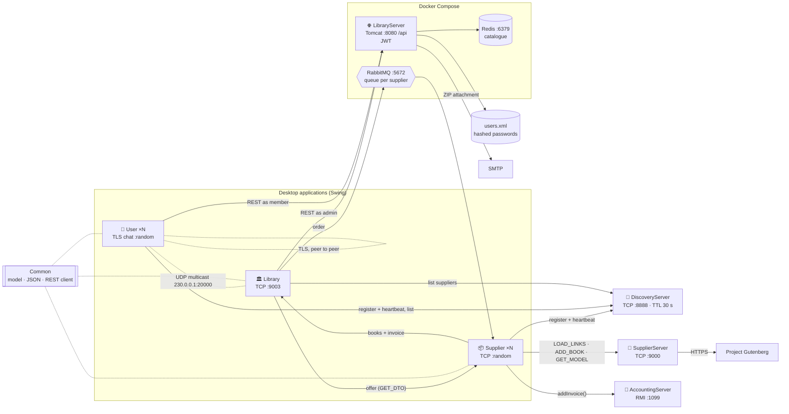
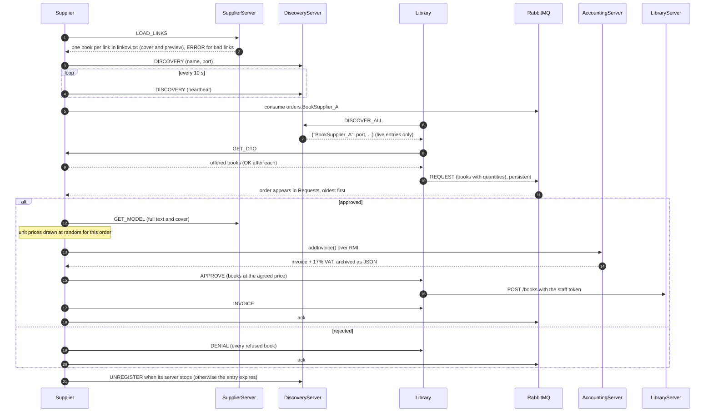
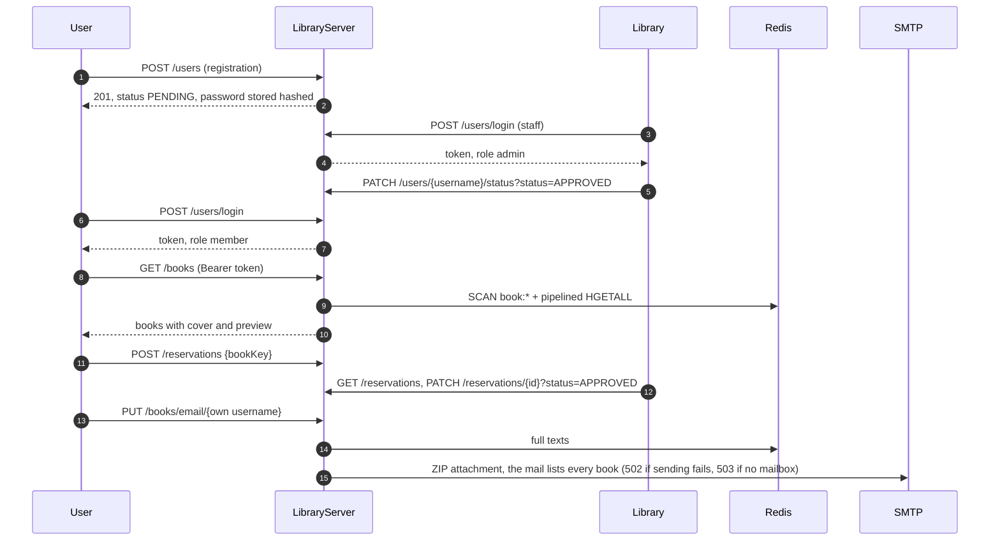

<div align="center">

# 📚 Online Library System

[](https://github.com/pero-grubac/Online-Library-System/actions/workflows/ci.yml)


**A distributed library: staff, members and book suppliers in seven Java applications that talk over REST, TCP sockets, TLS, UDP multicast, RabbitMQ and RMI.**


</div>

---

## 📌 Project Overview

**Online Library System** simulates an online library. Members register and borrow e-books, the library staff approve members and keep the catalogue, and suppliers sell new books to the library. Books come from [Project Gutenberg](https://www.gutenberg.org/), are stored in Redis, and reach members as a ZIP file by e-mail.

Every communication technology of the course is used for the job it fits best: REST for the shared catalogue, plain sockets for service discovery and book transfer, a message queue for orders, RMI for invoicing, TLS sockets for private chat and multicast for the group chat. All of them, except RMI, carry the same JSON messages.

| Application | Who uses it | What it does |
|-------------|-------------|--------------|
| 🏛️ **Library** (Swing) | Library staff | Approves, edits and blocks members; manages the catalogue; browses supplier offers and orders books |
| 👤 **User** (Swing) | Members | Registers, logs in, browses and previews books, gets them by e-mail, chats |
| 📦 **Supplier** (Swing) | Book suppliers | Publishes an offer, reviews the library's orders, ships books and issues invoices |
| 🌐 **LibraryServer** (Tomcat) | Library and members | Secured REST API over the member store (XML) and the catalogue (Redis); sends books by e-mail |
| 🧭 **DiscoveryServer** | Suppliers and members | Registry of who is online and on which port, with heartbeats |
| 📖 **SupplierServer** | Suppliers | Downloads books and covers from Project Gutenberg and keeps each supplier's copies |
| 🧾 **AccountingServer** (RMI) | Suppliers | Adds 17% VAT to invoices and archives them as JSON |

---

## ✨ Features

### 🏛️ Library

- **Members**: table of all accounts with a status filter; approve or reject registrations, block, add (active at once), edit and delete
- **Catalogue (CRUD)** in Redis: add a book with cover and text file, edit it (text and cover are kept unless replaced), delete it, open its details
- **Reservations**: every book reservation sent by members, to confirm or reject
- **Proposals**: members' proposals for new books arrive by multicast; the answer ("will / will not be acquired") goes back to all members the same way
- **Ordering**: finds online suppliers through the DiscoveryServer, shows their offer, cart with a **quantity per book**, order through RabbitMQ
- Approved books appear in the catalogue by themselves; invoices (with VAT) and rejections arrive as notices
- Group chat with the members; only one library application can run at a time

<details open>
<summary><b>Catalogue</b>: add a book with cover and text, details, edit, delete</summary>
<br>

</details>

<details>
<summary><b>Members</b>: status filter, approve, reject, block, add, edit, delete</summary>
<br>

</details>

<details>
<summary><b>Reservations, proposals and group chat</b></summary>
<br>

</details>

### 👤 Member

- Registration (password entered twice) and login over REST; until the library approves the account, login says so
- Book table with search by title, author or language; **Details** shows title, cover and the first 100 lines
- Tick several books to **reserve** them or to have them **e-mailed** as one ZIP (the mail lists every book); a failed mail is reported, never shown as sent
- **Propose a book** to the library and all members by multicast, and see the library's answer
- **Private chat** over TLS sockets, peer to peer, with unread messages marked
- **Group chat** over UDP multicast

<details open>
<summary><b>Account</b>: registration, pending approval, login</summary>
<br>

</details>

<details>
<summary><b>Books</b>: search, details, reserve, my reservations, e-mail</summary>
<br>

</details>

<details>
<summary><b>Community</b>: proposals, group chat, private chat, the library's answers</summary>
<br>

</details>

### 📦 Supplier

- On login the **SupplierServer reads the supplier's `linkovi.txt`**, downloads every book from Project Gutenberg and parses title, author, language and release date; the cover link is derived from the book link. Books appear while they download, and a broken link does not stop the rest
- More books can be added **by hand** (title, author, language, date, cover image, text file) or from a single Gutenberg link; text and cover are stored on the SupplierServer
- Runs its own TCP server on a free port, registers it with the DiscoveryServer and renews it every 10 seconds; a second window with the same supplier name is refused
- Has its own durable order queue: orders wait for it while it is offline, arrive oldest first and stay queued until they are approved or rejected, even if the application is closed in between
- On approval the price is set **per order at random** (`PRICE_MIN`–`PRICE_MAX`), the invoice is booked over RMI and the supplier sees the **17% VAT**; books and invoice go to the library. A rejection is reported to the library as well

<details open>
<summary><b>Offer</b>: books from <code>linkovi.txt</code>, details, a book entered by hand, a book from a link, reload</summary>
<br>

</details>

<details>
<summary><b>Requests</b>: approve an order (invoice with VAT) or reject it</summary>
<br>

</details>

### 🔐 Security

- **Passwords** are stored as salted PBKDF2-HMAC-SHA256 hashes (600,000 iterations). Passwords saved in plain text by older versions are re-hashed on the member's next login.
- **Sessions** are signed JWTs (HS256, 8 hours) with a `member` or `admin` role, sent as `Authorization: Bearer`.
- **Authorization** is closed by default: an endpoint without `@PermitAll` needs a token, and a member gets `403` on staff endpoints. Members can only e-mail books to themselves, and a blocked member loses access immediately, not when the token expires.
- **No Java deserialization on the network.** Sockets, RabbitMQ and multicast carry JSON, and the receiver names the type it expects. Messages are capped at 32 MB. RMI, the one exception, runs behind a JEP 290 allow-list filter.
- **Secrets** (staff password, token key, mail password) come from environment variables, never from Git.

---

## 🛠️ Tech Stack

| Technology | Usage |
|------------|-------|
| Java 17+ | All seven applications |
| Swing | Desktop GUIs (Library, User, Supplier) |
| JAX-RS (Jersey 2) on Tomcat 9 | LibraryServer REST API |
| JWT (`java-jwt`), PBKDF2 | Sessions and password hashing |
| Redis 7 (Jedis) | Book catalogue, one hash per book, read with `SCAN` and pipelining |
| `XMLEncoder` / `XMLDecoder` | Member store |
| RabbitMQ (durable direct exchange) | Orders from the library to a supplier |
| Java RMI + JEP 290 filter | Invoices from the supplier to the AccountingServer |
| TCP sockets, JSON lines (Gson) | Discovery, supplier offers, book delivery |
| TLS sockets (JSSE) | Private chat between members |
| UDP multicast | Group chat |
| `java.net.http.HttpClient` | REST client of the desktop apps |
| JavaMail | Books by e-mail as a ZIP attachment |
| `java.util.logging` | One log file per application (`log/logs.log`) |
| Maven | Multi-module build, runnable jars and the WAR |
| JUnit 5, AssertJ, Jersey Test, Testcontainers | Tests |
| Docker Compose | Redis, RabbitMQ and LibraryServer |
| GitHub Actions | CI: build, all tests, Docker image |

---

## 📁 Repository Structure

```
Online-Library-System/
├── pom.xml                  parent build for all modules
├── docker-compose.yml       Redis, RabbitMQ and LibraryServer
├── .env.example             staff password, token key and mail settings
│
├── Common/                  shared model, JSON protocol, REST client, RMI filter
├── LibraryServer/           REST API (WAR, Dockerfile)
├── DiscoveryServer/         TCP registry of suppliers and members
├── SupplierServer/          Project Gutenberg downloader (suppliers/*/linkovi.txt)
├── AccountingServer/        RMI invoicing
├── Library/                 staff GUI
├── Supplier/                supplier GUI
├── User/                    member GUI
│
└── .github/workflows/ci.yml
```

`Common` and `LibraryServer` use the standard Maven layout. The other modules keep their original one:

```
<Module>/
├── src/org/unibl/etf/mdp/...         code, with app.properties next to the AppConfig that reads it
└── test/java/org/unibl/etf/mdp/...   tests
```

All ports, message names and paths are in each module's `app.properties`.

---

## 🚀 Installation & Running

### Prerequisites

| Tool | Version | Used for |
|------|---------|----------|
| JDK | **17 or newer** (tested on 21) | Everything |
| Maven | 3.9+ | Build and tests |
| Docker + Docker Compose | recent | Redis, RabbitMQ, LibraryServer, and the Redis / RabbitMQ tests |
| Internet access | | SupplierServer downloads books from gutenberg.org |

In IntelliJ IDEA open the folder and choose **Load Maven Project**; every module, `Common` included, is picked up from the `pom.xml` files.

### 1. Clone and build

```bash
git clone https://github.com/pero-grubac/Online-Library-System.git
cd Online-Library-System
mvn package
```

This builds every module, runs all tests and produces:

| Artifact | Path |
|----------|------|
| REST API | `LibraryServer/target/LibraryServer.war` |
| Servers | `DiscoveryServer/target/discovery-server.jar`, `SupplierServer/target/supplier-server.jar`, `AccountingServer/target/accounting-server.jar` |
| GUIs | `Library/target/library.jar`, `Supplier/target/supplier.jar`, `User/target/user.jar` |

Use `mvn package -DskipTests` for a faster build.

### 2. Secrets

Copy `.env.example` to `.env` and set at least:

| Variable | Purpose |
|----------|---------|
| `ADMIN_PASSWORD` | Password of the staff account (`ADMIN_USERNAME`, default `admin`) |
| `JWT_SECRET` | Key that signs session tokens, e.g. `openssl rand -base64 48`. Empty means a random key per start, so everyone logs in again after a restart |
| `MAIL_USERNAME`, `MAIL_PASSWORD` | Optional: the mailbox that sends books. For Gmail use an [App Password](https://support.google.com/accounts/answer/185833) |

Without a `.env` the staff password is `admin`; that is meant for local development only.

Every key in `LibraryServer/src/main/resources/.../app.properties` can be overridden by an environment variable of the same name.

### 3. Start the infrastructure and the REST API

```bash
docker compose up -d --build
```

| Service | Address |
|---------|---------|
| LibraryServer API | http://localhost:8080/LibraryServer/api/ |
| RabbitMQ management | http://localhost:15672 (guest / guest) |
| Redis | `localhost:6379` |

Ten demo members (`john`, `jane`, …, password = username) are created on the first start. They are `PENDING`, so approve one in the Library app before logging in with it.

<details>
<summary>Without Docker: deploy the WAR to your own Tomcat 9</summary>

```bash
docker compose up -d redis rabbitmq        # or run Redis and RabbitMQ yourself
cp LibraryServer/target/LibraryServer.war <TOMCAT_HOME>/webapps/
<TOMCAT_HOME>/bin/startup.sh               # startup.bat on Windows
```

Set `ADMIN_PASSWORD`, `JWT_SECRET` and the mail variables in Tomcat's environment (e.g. `bin/setenv.sh`).
</details>

### 4. Start the applications

> ⚠️ Start them **in this order**, each in its own terminal, **from the module's folder**: relative paths such as `suppliers/` and `log/` resolve against it.

| # | Application | Command |
|---|-------------|---------|
| 1 | DiscoveryServer | `cd DiscoveryServer && java -jar target/discovery-server.jar` |
| 2 | AccountingServer | `cd AccountingServer && java -jar target/accounting-server.jar` |
| 3 | SupplierServer | `cd SupplierServer && java -jar target/supplier-server.jar` |
| 4 | Supplier GUI | `cd Supplier && java -jar target/supplier.jar` |
| 5 | Library GUI | `cd Library && java -jar target/library.jar` |
| 6 | User GUI | `cd User && java -jar target/user.jar` (see below) |

The Library app logs in as staff when it starts. If you changed `ADMIN_PASSWORD`, give it the same value:

```bash
LIBRARY_ADMIN_PASSWORD=your-password java -jar target/library.jar    # PowerShell: $env:LIBRARY_ADMIN_PASSWORD="..."
```

Several Supplier and User windows can run at once (in IntelliJ, enable **Allow multiple instances**). Log in to the Supplier app as `BookSupplier_A`, `BookSupplier_B` or `BookSupplier_C` (`SUPPLIER_NAMES` in its `app.properties`); each one's Gutenberg links are in `SupplierServer/suppliers/<name>/linkovi.txt`, one link per line.

> 💡 If the Supplier app reports `PKIX path building failed` for every book, Java does not trust the certificate it sees for gutenberg.org (typical behind a company proxy or an antivirus that inspects HTTPS). On Windows, let the SupplierServer use the Windows certificate store:
> `java -Djavax.net.ssl.trustStoreType=Windows-ROOT -jar target/supplier-server.jar`

#### Member chat keystore (once)

Private chat uses TLS, so the User app needs a key pair. `User/keystore.jks` is not committed; create it with:

```bash
cd User
keytool -genkeypair -alias user -keyalg RSA -keysize 2048 -validity 365 \
        -dname "CN=localhost" -keystore keystore.jks \
        -storepass password123 -keypass password123
```

The path and password are `KEY_STORE_PATH` / `KEY_STORE_PASSWORD` in `User/src/.../app.properties`.

### 5. Stop

Close the GUIs, stop the servers with `Ctrl+C`, then `docker compose down`. Add `-v` to delete the Redis data, the order queues and the member store.

---

## 🧪 Tests

```bash
mvn test                                  # all modules
mvn test -pl LibraryServer -am            # one module (and Common, which it needs)
mvn test -pl LibraryServer -am -Dtest=AuthorizationTest -Dsurefire.failIfNoSpecifiedTests=false
```

**171 tests** run on every push in GitHub Actions. Socket and RMI tests open their own servers on free ports, and the REST API runs in memory. Redis and RabbitMQ run in throwaway containers through Testcontainers; those tests are skipped when Docker is not available.

| Module | What is tested | How |
|--------|----------------|-----|
| Common | JSON round trip of books, lists, invoices and dates; EOF; malformed, typeless and oversized messages rejected | Real TCP socket |
| | Multicast dispatch by type, garbage dropped, own message shown once, an answer replaces its proposal and is never undone | Datagrams fed in directly |
| | Invoice totals with quantities, orders need at least one copy, chat messages identified by id | Unit |
| | Bearer token on every method, transparent renewal of an expired session, logout | Local `HttpServer` |
| | Invoices pass the RMI filter, foreign classes are rejected | Java serialization |
| LibraryServer | 401 without a token on every protected endpoint, 403 for members on staff endpoints, forged tokens, blocked member cut off at once, e-mail only to oneself | Jersey Test, in memory |
| | Registration, unique usernames, staff name reserved, approval before login, status changes, profile update, persistence | REST + `UserService` on a temporary store |
| | Hashes salted and never containing the password, iteration count read from the hash, plain-text passwords upgraded on login | Unit |
| | Tokens carry user and role, expire, and are rejected when signed with another key or tampered with | Fixed clock |
| | Redis catalogue: save, read, list across many `SCAN` pages, delete; preview; a separate UTF-8 ZIP per request; books without a release date | Testcontainers (`redis:7-alpine`) |
| | Editing keeps text and cover, renaming moves the key, renaming onto another book is a conflict | Testcontainers |
| | Reservations over HTTP: reserve, no duplicate pending reservation, unknown book, members see only their own, confirm once | Jersey Test + Testcontainers |
| | Pending or blocked member told why on login (403), registration needs every field, mail without a mailbox is 503 | Jersey Test, in memory |
| DiscoveryServer | Registration, listing, heartbeat, a second client with the same name refused, port as text or number, invalid port, unregister | Real TCP socket |
| | Entries expire without heartbeat, heartbeats keep them, sorted output | Manual clock |
| AccountingServer | 17% VAT on quantities and rounding, JSON archive with items and no covers, two invoices of one day kept apart, a failed save reported to the supplier, call through an RMI registry with the filter on | Unit + real RMI |
| SupplierServer | Header parsing in every release-date spelling, cover derived from the link, missing cover, broken link, offer from `linkovi.txt` despite a broken link, books entered by hand with their cover, links and hand-entered books kept in the offer after a reload, `GET_MODEL` with cover | Local `file://` copies of Gutenberg books + TCP |
| Supplier | Offer streaming with `OK` acknowledgements; register, heartbeat, unregister, name taken, DiscoveryServer down | TCP + fake DiscoveryServer |
| | Approval prices the order and books the invoice before any book is sent; unreachable library or accounting changes nothing; rejection names every book | Fake library socket + fake RMI service |
| | Order sent while offline arrives with quantities; an order not yet handled comes back after the app is closed; a handled one is gone; malformed order dropped | Testcontainers (`rabbitmq:3-alpine`) |
| Library | Reading a supplier's offer, empty or unreachable supplier; order stored as persistent JSON; delivered books into the catalogue, invoice and rejection notices, a book the server refuses; a second library cannot start | Fake supplier + real server socket + Testcontainers |
| User | Chat history per conversation, listeners | Unit |

Tests write only under `target/` or into folders they delete afterwards.

---

## 🏗️ Architecture

### Components and protocols



Every application depends on `Common`, which holds the model (`Book`, `BookDto`, `Invoice`, `Message`, …), the JSON format, `JsonChannel` for sockets, `RestClient` for the API and the RMI filter. There is one copy of each class, so the two ends of a protocol cannot drift apart.

| From → To | Protocol | Port | Payload |
|-----------|----------|------|---------|
| Library, User → LibraryServer | HTTP / JSON, Bearer token | 8080 | Members, books, reservations, e-mail requests |
| LibraryServer → Redis | RESP (Jedis) | 6379 | `book:<author>:<title>:<language>:<date>` hashes |
| Supplier, User, Library → DiscoveryServer | TCP, JSON lines | 8888 | `DISCOVERY`, `DISCOVER_USER` (answer `OK` or `TAKEN`), `UNREGISTER`, `DISCOVER_ALL`, `GET_ALL_USERS`, `END` |
| Library → Supplier | TCP, JSON lines | registered | `GET_DTO` → stream of offers, each acknowledged with `OK` |
| Library → Supplier | AMQP, durable exchange `library.orders` → queue `orders.<supplier>` | 5672 | `REQUEST` with the ordered books and quantities, persistent, acknowledged once handled |
| Supplier → Library | TCP, JSON lines | 9003 | `APPROVE` (one book each), `INVOICE`, `DENIAL`, `END` |
| Supplier → SupplierServer | TCP, JSON lines | 9000 | `LOAD_LINKS` (the whole `linkovi.txt` → one `GET_DTO` per book, `ERROR` per bad link, `END`), `GET_DTO` (one link), `ADD_BOOK` (entered by hand), `GET_MODEL` (full book with cover) |
| Supplier → AccountingServer | Java RMI, JEP 290 filter | 1099 | `addInvoice(invoice, supplier)` |
| User ↔ User | TLS socket, JSON lines | registered | Private messages |
| User, Library | UDP multicast, JSON datagram | 20000 | `GROUP_MESSAGE`, `PROPOSAL`, `PROPOSAL_ANSWER` |

A JSON line is one `Message` per line: `{"type":"GET_DTO","username":"BookSupplier_A","body":{…}}`.

### Ordering books from a supplier



### A member gets books



### REST API

Base URL `http://localhost:8080/LibraryServer/api`. Send the token from `/users/login` as `Authorization: Bearer <token>`.

| Method | Path | Who | Description | Responses |
|--------|------|-----|-------------|-----------|
| `POST` | `/users` | anyone | Register a member | 201, 400, 409 username taken |
| `POST` | `/users/login` | anyone | `{token, tokenType, expiresIn, username, role}` | 200, 401, 403 not approved yet or blocked |
| `GET` | `/users` | admin | All members (no passwords) | 200 |
| `PUT` | `/users` | admin | Update a member's profile and status | 200, 400 |
| `DELETE` | `/users/{username}` | admin | Delete a member | 200, 404 |
| `PATCH` | `/users/{username}/status?status=` | admin | `APPROVED`, `REJECTED` or `BLOCKED` | 200, 400 |
| `GET` | `/books` | member, admin | Catalogue with previews | 200 |
| `GET` | `/books/{key}` | member, admin | One book with the full text | 200, 404 |
| `POST` | `/books` | admin | Add a book | 201, 400 |
| `PUT` | `/books/{key}` | admin | Edit a book; text and cover are kept when left out | 200, 400, 404, 409 |
| `DELETE` | `/books/{key}` | admin | Remove a book | 204, 404 |
| `PUT` | `/books/email/{username}` | member (self), admin | E-mail the listed books as a ZIP | 200, 400, 403, 404, 502, 503 |
| `POST` | `/reservations` | member | Reserve a book: `{"bookKey": "..."}` | 201, 400, 404, 409 already pending |
| `GET` | `/reservations` | admin | All reservations, oldest first | 200 |
| `GET` | `/reservations/mine` | member | The caller's reservations | 200 |
| `PATCH` | `/reservations/{id}?status=` | admin | `APPROVED` or `REJECTED`, once | 200, 400, 404, 409 |

Every protected endpoint answers `401` without a valid token and `403` for the wrong role.

---

## 🧭 Design Decisions

- **One protocol per job.** The catalogue is shared state, so it sits behind REST. Discovery and bulk transfer are request/response, so they use sockets. Orders must reach a supplier that may be offline, so they go through a durable queue. Invoicing is a remote method call, so it uses RMI.
- **JSON instead of Java serialization.** A serialized object can run code while it is read, so nothing from the network is deserialized blindly. A message is plain JSON and the receiver decodes the body into the one type it expects. RMI cannot avoid serialization, so it only accepts the system's own classes.
- **Closed by default.** The security filter rejects any endpoint that does not declare who may call it. Tokens are short-lived and signed, and a member's status is checked on every request.
- **Self-healing discovery.** Suppliers and members bind to a free port, register it and renew it with a heartbeat. Entries that stop renewing expire after 30 seconds, so a crashed client never stays listed.
- **One shared model.** `Common` holds the only copy of every message and model class, so a change shows up on both ends of a protocol at once.
- **DTO and full model.** Lists carry `BookDto` (metadata, cover, 100-line preview). The full text (`Book`) is fetched only when it is really needed: for delivery to the library and for e-mail to a member.
- **Stable book keys.** A book is identified by author, title, language and release date, normalised into one Redis key, so the same book from two suppliers is stored once.
- **Configuration outside the code.** Ports, message names and paths are in `app.properties`, and secrets come from environment variables.
- **Testable without the whole system.** Services accept their dependencies (connection, repository, clock) through constructors, and every protocol is tested over a real socket, queue or registry.

---

## 📄 License

See [LICENSE](LICENSE).
